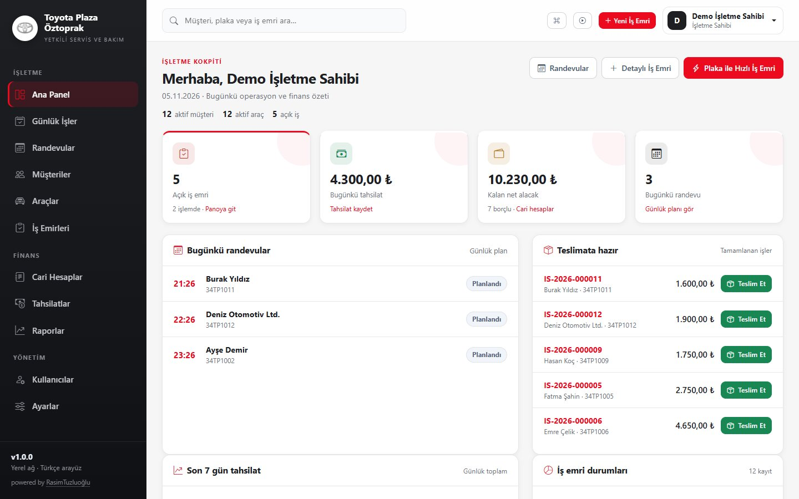
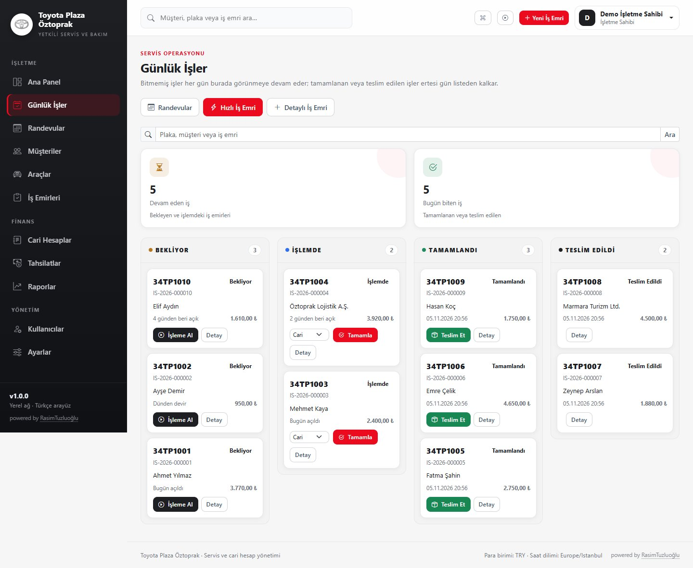
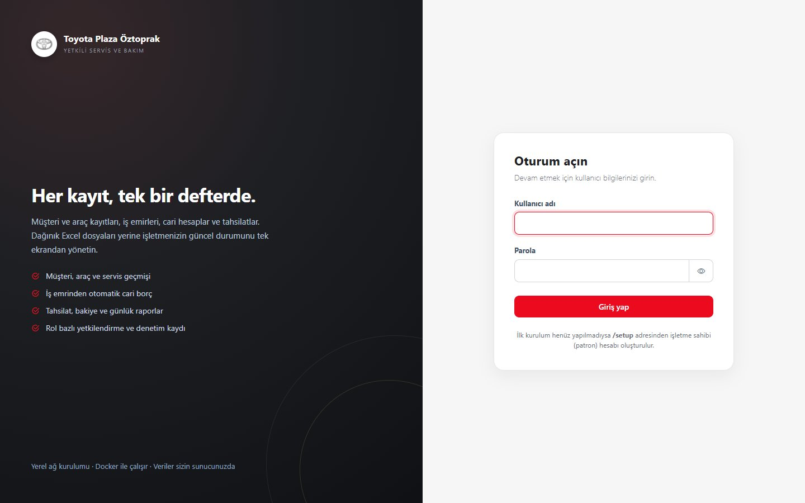

# Toyota Plaza Öztoprak · Servis Yönetimi

Toyota Plaza Öztoprak için geliştirilen bu uygulama; müşteri, araç, iş emri, cari hesap ve tahsilat süreçlerini tek bir yerel ağ uygulamasında toplar. Excel dosyaları ve kâğıt defterler yerine tek kaynaklı, izlenebilir ve yetkilendirilmiş bir kayıt sistemi hedeflenir.

## Kapsam

İlk sürümde çalışan modüller:

- Kullanıcı girişi, PATRON / MUHASEBE / SERVIS rolleri, herkes için kendi parolasını değiştirme
- Müşteri (bireysel / firma) kayıtları, arama, aktif-pasif yönetimi
- Araç kayıtları, mükerrer plaka kontrolü, sahiplik geçmişi, servis geçmişi
- İş emirleri, durum akışı, işçilik/parça kalemleri, sunucu tarafı tutar hesabı
- Günlük iş panosu: bitmemiş işler her gün devreder; biten işler ertesi gün listeden kalkar
- Kanban panosunda sürükle-bırak veya tek tıkla durum ilerletme; plaka/müşteri araması ve telefonda sekmeli görünüm
- Haftalık randevu takvimi; randevuyu “Geldi” yapıp plakası ön dolu hızlı iş emrini tek akışta açma
- Araç kabul ve teslim tutanağında tablet/masaüstü dijital imza
- Bakım hatırlatmaları: 180 gün veya 10.000 km geçen araçlar
- Ctrl+K komut paleti ve 6 adımlık sunum turu
- Plaka ile hızlı iş emri: kayıtlı plaka müşteri ve araçla eşleşir; kayıtsız plakada müşteri + araç + iş emri tek adımda oluşur
- Tek ekranda hızlı iş emri: plaka yazınca otomatik eşleşme, hazır işlem düğmeleri ve “Kaydet ve Tamamla”
- Tamamla + tahsilat (Cari/Nakit/Kart), tek tık teslim ve 10 dakikalık “Geri Al”
- Ayarlar → GitHub son commit kontrolü ve host ajanıyla Docker üzerinden güncelleme
- Manuel veya otomatik iş emri numarası; mükerrer numara engeli
- Hazır işçilik/parça kalem şablonları ve son baktığınız işlere hızlı erişim
- Araç kabul formu (yakıt, hasar notu, eşyalar), teslim tutanağı ve ıslak imza çıktısı
- Günlük randevu takvimi; randevudan tek tıkla iş emri açma
- Cari yaşlandırma raporu (0-30 / 31-60 / 61+ gün)
- İş emri için manuel WhatsApp metin paylaşımı
- Rapor ve listelerde tarih ön ayarları (Bugün / Bu Hafta / Bu Ay / Geçen Ay)
- Mobil ve tablet uyumlu arayüz, ana ekrana kısayol (manifest) ve klavye kısayolları (`/`, `Alt+N`, `Alt+B`)
- Türkçe karakter duyarlı arama (İ/I, ş/s, ğ/g normalizasyonu)
- İş emri tamamlandığında otomatik cari borç; iptalde ters kayıt
- Cari hesap hareketleri, müşteri ekstresi, CSV dışa aktarım
- Tahsilatlar, birden fazla borca dağıtım, tahsilat iptali (ters kayıt)
- Dashboard ve gerçek verilerden üretilen raporlar
- Denetim kaydı (audit log)
- White-label marka ayarı: işletme adı, slogan, ana renk ve logo (giriş ekranı, menü, PDF ve belgeler dahil)
- Excel (.xlsx) ve CSV dışa aktarma: müşteri, araç, iş emri, tahsilat listeleri ile tüm raporlar
- İş emri ve tahsilat makbuzu için doğrudan PDF indirme
- `pg_dump` tabanlı yedekleme; sunucu klasörü seçimi ve tarayıcıdan istediğiniz klasöre indirme
- Docker Compose ile uygulama + PostgreSQL kurulumu

Kapsam dışı (bilerek uygulanmadı): e-fatura, banka/kart ödeme kuruluşu entegrasyonu, SMS/WhatsApp otomasyonu, bulut dış erişim, çok işletmeli SaaS, tam stok/depo, araç kiralama sözleşmeleri, native mobil uygulama, tam muhasebe sistemi.

## Ekran Görüntüleri

Yeni Toyota temalı kokpit ve kanban iş panosu:







## Demo / Sunum Ortamı

Gerçek veriyi kirletmeden, gerçekçi örnek verilerle sistemi göstermek için ayrı bir demo ortamı vardır.

```bash
docker compose up -d --build
docker compose -f docker-compose.demo.yml up -d
```

- Adres: `http://localhost:18081`
- Kullanıcı: `demo`
- Parola: `DemoPass1234`

Demo verisi yalnızca `demo` profilinde ve boş veritabanında oluşturulur; normal üretim veritabanına dokunmaz. Sıfırlamak için:

```bash
docker compose -f docker-compose.demo.yml down -v
docker compose -f docker-compose.demo.yml up -d
```

Demo verisi: 12 müşteri, 12 Toyota araç, 12 iş emri, 5 tahsilat ve 4 randevu. Demo kullanıcısı yalnızca demo veritabanında oluşturulur.

### 5 dakikalık sunum akışı

1. **Demo girişi** → `demo / DemoPass1234`
2. **Ana Panel** → günlük tahsilat, alacak, randevu ve durum grafiklerini gösterin.
3. **Günlük İşler** → kanban panosunda “İşleme Al” ve “Tamamla” akışını gösterin.
4. **Yeni İş Emri** → plaka ile arama ve kayıtlı plakada otomatik müşteri/araç eşleşmesini gösterin.
5. **İş emri detayı** → süreç adımları, kabul formu, teslim tutanağı ve PDF çıktısını açın.
6. **Tahsilat** → müşteri bakiyesi ve makbuz PDF’ini gösterin.
7. **Raporlar** → cari yaşlandırma ve Excel/CSV indirmeyi gösterin.


## Teknolojiler

| Katman | Teknoloji |
|---|---|
| Dil | Java 21 LTS |
| Çatı | Spring Boot 3.5.16 |
| Web | Spring MVC + Thymeleaf |
| Veri | Spring Data JPA / Hibernate, PostgreSQL 16 |
| Dışa aktarma | Apache POI 5.5.1 (Excel .xlsx), UTF-8 BOM CSV |
| PDF | OpenPDF 2.2.2, Noto Sans (gömülü Türkçe karakter desteği) |
| Migration | Flyway |
| Güvenlik | Spring Security, BCrypt (strength 12), CSRF |
| UI | Bootstrap 5.3.3, Bootstrap Icons, özel CSS |
| Test | JUnit 5, Spring Boot Test, MockMvc, Testcontainers (PostgreSQL 16) |
| Paketleme | Maven, Docker, Docker Compose |

## Gereksinimler

- JDK 21
- Maven 3.9+
- Docker Desktop / Docker Engine + Compose (Docker kurulumu ve Testcontainers testleri için)
- Yerel geliştirmede PostgreSQL 16 (Docker ile ayağa kaldırılabilir)

## Hızlı Başlangıç (Docker)

1. Ortam dosyasını oluşturun:

   ```bash
   cp .env.example .env
   ```

   Windows PowerShell: `Copy-Item .env.example .env`

2. `.env` içinde en az `POSTGRES_PASSWORD` değerini değiştirin. İlk işletme sahibini ortam değişkeninden oluşturmak isterseniz `INITIAL_ADMIN_USERNAME`, `INITIAL_ADMIN_PASSWORD` ve `INITIAL_ADMIN_FULL_NAME` değerlerini de doldurun. **Varsayılan parola yoktur.**

3. Servisleri başlatın:

   ```bash
   docker compose up -d --build
   docker compose ps
   docker compose logs -f app
   ```

4. Tarayıcıdan `http://localhost:18080` adresini açın. Kullanıcı yoksa `/setup` ekranından ilk PATRON (işletme sahibi) hesabını oluşturun.

5. Durdurma:

   ```bash
   docker compose down
   docker compose restart app
   ```

   > `docker compose down -v` komutu **volume'ları siler** ve veritabanı kayıtlarını geri döndürülemez biçimde kaybettirir. Normal kullanımda `-v` kullanmayın.

PostgreSQL portu ana compose dosyasında bilerek yayınlanmaz. Yerel geliştirmede veritabanına host üzerinden erişmek için:

```bash
docker compose -f docker-compose.yml -f compose.dev.yml up -d db
```

Bu komut portu yalnızca `127.0.0.1:5432` üzerinde açar.

## Yerel Geliştirme

```bash
# 1) PostgreSQL 16
docker compose -f docker-compose.yml -f compose.dev.yml up -d db

# 2) Uygulama
set DB_URL=jdbc:postgresql://localhost:5432/servisdefteri
set DB_USERNAME=servisdefteri
set DB_PASSWORD=<.env icindeki POSTGRES_PASSWORD>
mvn spring-boot:run -Dspring-boot.run.profiles=dev
```

PowerShell kullanıyorsanız `set` yerine:

```powershell
$env:DB_URL="jdbc:postgresql://localhost:5432/servisdefteri"
$env:DB_USERNAME="servisdefteri"
$env:DB_PASSWORD="..."
mvn spring-boot:run "-Dspring-boot.run.profiles=dev"
```

Varsayılan port `18080`'dir (8080 başka uygulamalar tarafından kullanılabildiği için bilinçli olarak seçildi). Port doluysa `SERVER_PORT` (uygulama) veya `APP_PORT` (Docker) ile değiştirin.

### İlk işletme sahibi (PATRON) hesabı

İki desteklenen yöntem vardır:

1. **Ortam değişkenleri:** Uygulama ilk açılışta kullanıcı yoksa `INITIAL_ADMIN_USERNAME` ve `INITIAL_ADMIN_PASSWORD` ile PATRON oluşturur. Parola en az 10 karakter, büyük harf, küçük harf ve rakam içermelidir.
2. **Kurulum ekranı:** Ortam değişkenleri boşsa tarayıcıdan `/setup` açılır. Bu ekran **yalnızca bir kez**, ilk PATRON hesabı oluşturulurken çalışır; sonrasında `/setup` giriş ekranına yönlenir ve kullanıcılar silinse bile yeniden açılmaz.

Oluşturulan parolalar BCrypt ile hashlenir; düz metin saklanmaz. README veya kaynak kodda varsayılan parola bulunmaz.

İlk girişten sonra **Kullanıcılar** ekranından muhasebe ve servis hesaplarını oluşturun. Roller:

| Rol | Kapsam |
|---|---|
| **PATRON** | Tüm işlemler: operasyon, finans, raporlar, kullanıcılar, ayarlar, yedekleme |
| **MUHASEBE** | Tahsilat, cari hesap ve raporlar; müşteri/araç/iş emri kayıtlarını yalnızca görüntüler, iş emri iptal edebilir |
| **SERVIS** | Müşteri, araç, iş emri ve günlük iş akışı; finans ekranlarına erişemez, iptal yapamaz |

## Ortam Değişkenleri

| Değişken | Açıklama | Varsayılan |
|---|---|---|
| `POSTGRES_DB` | Veritabanı adı | `servisdefteri` |
| `POSTGRES_USER` | Veritabanı kullanıcısı | `servisdefteri` |
| `POSTGRES_PASSWORD` | Veritabanı parolası | Zorunlu |
| `APP_PORT` | Docker'da dış port | `18080` |
| `APP_BIND_ADDRESS` | Dinlenecek ağ arayüzü; `127.0.0.1` = yalnızca bu bilgisayar, `0.0.0.0` = yerel ağ | `0.0.0.0` |
| `SERVER_PORT` | Uygulama portu | `18080` |
| `SESSION_TIMEOUT` | Oturum süresi | `2h` |
| `DB_URL` | JDBC adresi | `jdbc:postgresql://localhost:5432/servisdefteri` |
| `DB_USERNAME` / `DB_PASSWORD` | Uygulama DB kullanıcısı | `servisdefteri` / zorunlu |
| `INITIAL_ADMIN_USERNAME` | İlk PATRON kullanıcı adı | Boş |
| `INITIAL_ADMIN_PASSWORD` | İlk PATRON parolası | Boş |
| `INITIAL_ADMIN_FULL_NAME` | İlk PATRON ad soyad | `İşletme Sahibi` |
| `BACKUP_ENABLED` | Zamanlanmış yedekleme | `true` |
| `BACKUP_DIR` | Yedek dizini | `./backups` (Docker: `/app/backups`) |
| `BACKUP_RETENTION_DAYS` | Yedek saklama süresi | `14` |
| `BACKUP_CRON` | Yedekleme cron ifadesi | `0 0 2 * * *` |
| `PG_DUMP_PATH` | pg_dump yolu | `pg_dump` |
| `DB_HOST` / `DB_PORT` / `DB_NAME` | Yedekleme bağlantısı | `localhost` / `5432` / `servisdefteri` |

`.env` dosyası Git'e eklenmez. Örnek değerler `.env.example` içindedir.

## Testler

```bash
mvn test
```

Testler gerçek PostgreSQL 16 üzerinde Testcontainers ile çalışır; Docker erişimi gerekir. Kapsam:

- Cari bakiye ve iş emri tutar hesapları
- Durum geçiş kuralları
- Müşteri, araç, iş emri ve tahsilat akışı
- Aynı iş emrinin iki kez borçlandırılmaması
- Başka müşterinin aracıyla iş emri açılamaması
- PATRON / MUHASEBE / SERVIS yetki matrisi
- Günlük iş panosunun devir ve bitiş davranışı
- Panodan tek tıkla durum ilerletme
- Plaka ile hızlı iş emri ve mükerrer kayıt engeli
- Türkçe karakter duyarlı arama ve plaka/telefon normalizasyonu
- Yetkisiz finansal iptal denemesi
- Negatif tutar reddi
- Eşzamanlı tahsilat tutarlılığı
- Flyway migration ve kısıt/index doğrulaması
- HTML form akışı (CSRF, form belirteci, yönlendirmeler)
- Tüm ana sayfaların Thymeleaf ile hatasız render edilmesi
- CSV çıktılarının UTF-8 BOM ile başlaması
- Türkçe karakter duyarlı arama ve plaka/telefon normalizasyonu
- Araç kabul/teslim tutanağı, PDF üretimi ve tamamlanmamış iş emri kontrolü
- Günlük randevu oluşturma ve çakışma kontrolü
- Excel/CSV dışa aktarma ve yetki kontrolü
- İş emri ve makbuz PDF üretimi
- Araç kabul/teslim tutanağı ve günlük randevu akışı

Son çalıştırma sonucu: **85 test, 0 hata** (`mvn clean package`). Ayrıntılı rapor `target/surefire-reports/` altındadır.

## Proje Yapısı

```text
src/main/java/tr/com/servisdefteri/
  account/      cari hareketler, bakiye, ters kayıt
  audit/        denetim kaydı
  backup/       pg_dump yedekleme
  common/       ortak hata, doğrulama, CSV, format
  config/       güvenlik, web, ilk işletme sahibi
  customer/     müşteri modülü
  dashboard/    ana panel
  payment/      tahsilat ve dağıtım
  report/       raporlar ve CSV
  search/       global arama
  security/     kullanıcı, rol, oturum
  settings/     ayarlar ve audit ekranı
  vehicle/      araç modülü
  workorder/    iş emri ve kalemler
src/main/resources/
  db/migration/ Flyway migration dosyaları
  templates/    Thymeleaf şablonları
  static/       CSS ve JavaScript
docs/           mimari, veritabanı, kurulum, yedekleme, kullanım
```

## Dokümantasyon

- [Mimari](docs/ARCHITECTURE.md)
- [Veritabanı](docs/DATABASE.md)
- [Kurulum](docs/INSTALLATION.md)
- [Yedekleme ve Geri Yükleme](docs/BACKUP-RESTORE.md)
- [Kullanıcı Rehberi](docs/USER-GUIDE.md)
- [Case Study](docs/CASE-STUDY.md)
- [Demo Video Senaryosu](docs/DEMO-VIDEO-SCRIPT.md)

## Güvenlik Notları

- Tüm yetki kontrolleri sunucu tarafındadır; menü/buton gizleme tek başına güvenlik sayılmaz.
- CSRF koruması açıktır. Formlar POST/Redirect/GET düzenindedir.
- Oturum sabitleme koruması ve 2 saatlik oturum süresi uygulanır (`SESSION_TIMEOUT` ile değiştirilebilir).
- Finansal iptaller PATRON/MUHASEBE ile sınırlıdır; iş emri durum geçişleri PATRON/SERVIS yetkisindedir.
- Parola, oturum belirteci ve gereksiz kişisel veri loglanmaz.
- Üretimde `spring.jpa.hibernate.ddl-auto=validate` kullanılır; şema yalnızca Flyway ile değişir.
- Yedek dosyaları web kökünde değildir; indirme yalnızca PATRON oturumuyla yapılır.

## Lisans / Kullanım

Bu proje Toyota Plaza Öztoprak için yerel işletme kullanımı amacıyla geliştirilmiştir. Gerçek müşteri verileriyle kullanmadan önce kendi yedekleme ve erişim politikanızı uygulayın.

---

<sub>powered by [RasimTuzluoğlu](https://www.linkedin.com/in/rasimtuzluoglu311/)</sub>

