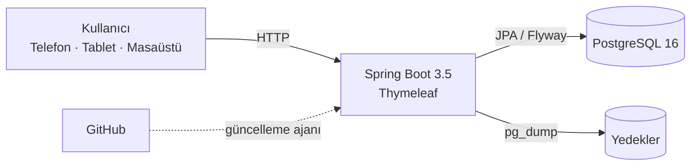

<p align="center">
  
</p>

<h1 align="center">Toyota Plaza Öztoprak · Servis Yönetimi</h1>

<p align="center">
  Müşteri, araç, iş emri, cari hesap, tahsilat ve randevuları tek defterde toplayan yerel ağ uygulaması.
  <br>
  <strong>Bulut yok. Dış servis yok. Veri işletmenin bilgisayarında.</strong>
</p>

<p align="center">
  
  
  
  
  
  
</p>

> **Durum:** Üretim ve demo ortamı çalışıyor · **134 otomatik test** · yerel CI + Docker imaj doğrulaması

## Bir bakışta

| Konu | Özet |
|---|---|
| **Kimin için?** | Toyota Plaza Öztoprak'ın günlük servis ve muhasebe operasyonu |
| **Nerede çalışır?** | Yerel ağda Docker ile; port yönlendirme veya bulut hesabı gerekmez |
| **Roller** | PATRON · MUHASEBE · SERVIS |
| **Günlük odak** | Az tıklama, hızlı iş emri, net tahsilat, güvenli geçmiş |

## Rol bazlı sade deneyim

| SERVIS | MUHASEBE | PATRON |
|---|---|---|
| Doğrudan **Bugün** panosuna düşer. Finans görmez; plaka odaklı iş emri açar, tek dokunuşla durumu ilerletir. | **Finans** özetiyle açılır: bugünkü tahsilat, kalan alacak, açık borçlar ve son tahsilatlar. Tek tıkla tahsilat alır. | Operasyon + finans + raporlar + kullanıcılar + ayarlar: işletmenin tam kokpiti. |

- **SERVIS:** Bugün, Randevular, Müşteriler, Araçlar, İşler, Günlük Döküm
- **MUHASEBE:** Özet, İş Emirleri, Günlük Döküm, Cari Hesaplar, Tahsilatlar, Raporlar
- Telefonda alt sabit menü; SERVIS'te **Döküm** kısayolu. Masaüstünde sabit sol menü ve 4 kolonlu pano.

## Öne çıkanlar

**⚡ Hızlı operasyon**
- Plaka, müşteri veya telefonla arama; kayıtlı plakada müşteri/araç otomatik gelir.
- Yeni plakada müşteri + araç + iş emri tek adımda oluşur.
- Kanban üzerinde sürükle-bırak veya tek tıkla **İşleme Al / Tamamla / Teslim Et**.
- Tamamlamadan sonra 10 dakika içinde **Geri Al**; borç varsa ters kayıt oluşur.
- Katlanabilir kolonlar ve yaş filtresi.
- Müşteri ve araç **Pasife Al / Geri Al**: geçmiş iş emri ve finans kayıtları korunur.
- **PATRON kalıcı silme**: iş emri, tahsilat, müşteri ve araç; yazılı onay ve zincirleme temizlik.

**📥 Excel dostu iş emri girişi**
- **Manuel fiş no**: otomatik üretilmez; Excel'den kopyalayıp yapıştırabilirsiniz.
- Yazarken mükerrer kontrolü; aynı numara kullanılamaz.
- **Kaydet ve Yeni** ile art arda kayıt.
- **CSV / XLSX / XLS içe aktarma**: en fazla 200 satır; önizleme ve onay adımı; bir satırda hata varsa hiçbir kayıt oluşmaz.
- "İlgilenen kişi" serbest metin; son kullanılan isimler chip olarak önerilir.

**💰 Finans**
- İş emri tamamlanınca otomatik cari borç; iptalde ters kayıt.
- Tamamla + tahsilat: **Cari / Nakit / Kart**.
- Tek açık borçta tutar ve dağıtım otomatik; dağıtım tablosu yalnızca çoklu borçta görünür.
- **Servis tahsilatı**: SERVIS iş emri ekranında kısmi veya tam tahsilat alabilir; kalanı MUHASEBE sonradan tahsil eder.
- Cari ekstre, yaşlandırma, tahsilat iptali ve PDF makbuz.

**📊 Raporlar**
- **Günlük Döküm**: seçilen günde açılan tüm iş emirleri; durum, tutar, tahsilat ve kalan.
- **Kalan = iş emri toplamı - tahsilat**; cari borç ayrıca Cari Hesaplar ekranında izlenir.
- Mobilde kart görünümü; Excel ve PDF indirme; PATRON, MUHASEBE ve SERVIS erişimi.

**📄 Belgeler ve marka**
- Araç kabul formu, teslim tutanağı, iş emri ve tahsilat makbuzu; PDF ve ıslak/dijital imza.
- Teslim tutanağı kaydedilince iş emri otomatik **Teslim Edildi** olur; teslim ekranında iş emri bazlı tahsilat açılır.
- White-label: işletme adı, slogan, ana renk ve logo; giriş, menü, belgeler ve PDF'lerde geçerli.

**🔐 Güvenlik, veri ve bakım**
- PATRON / MUHASEBE / SERVIS rolleri; yetkiler sunucu tarafında uygulanır.
- CSRF, BCrypt (strength 12), oturum sabitleme, IP + kullanıcı bazlı giriş denemesi sınırı.
- CSP, `X-Frame-Options: DENY`, `SameSite=Lax` oturum çerezi; TLS arkasında `Secure` çerez desteği.
- CSV formül enjeksiyonuna karşı hücre temizliği; müşteri/araç toplu dışa aktarımı PATRON/MUHASEBE ile sınırlı.
- İşlem denetim kaydı: kullanıcı, zaman, IP ve detay.
- Günlük otomatik yedek; kaçırılan yedek açılışta telafi edilir.
- Güncelleme öncesi yedek, GitHub son commit kontrolü ve host ajanıyla Docker güncellemesi.

> **Ağ notu:** Varsayılan olarak uygulama yalnızca **bu bilgisayara** (`127.0.0.1`) bağlanır. Yerel ağdaki tablet/telefon için `APP_BIND_ADDRESS=0.0.0.0` yapın; bu durumda güvenilir bir ağ kullanın, TLS sonlandıran reverse proxy ekleyin ve `SESSION_COOKIE_SECURE=true` ayarlayın.

## Mimari



Modüler monolit: tek Spring Boot uygulaması, tek PostgreSQL veritabanı, sunucu tarafında üretilen Thymeleaf HTML. Mikroservis, ayrı SPA veya mesaj kuyruğu yok.

## Teknolojiler

| Katman | Teknoloji |
|---|---|
| Dil | Java 21 LTS |
| Çatı | Spring Boot 3.5.16 |
| Web | Spring MVC + Thymeleaf |
| Veri | Spring Data JPA / Hibernate, PostgreSQL 16 |
| Migration | Flyway (V17) |
| Güvenlik | Spring Security, BCrypt (strength 12), CSRF |
| Dışa aktarma | Apache POI 5.5.1 (Excel .xlsx), UTF-8 BOM CSV |
| PDF | OpenPDF 2.2.2, gömülü Noto Sans |
| UI | Bootstrap 5.3.3, Bootstrap Icons, özel CSS |
| Test | JUnit 5, Spring Boot Test, MockMvc, Testcontainers (PostgreSQL 16) |
| Paketleme | Maven, Docker, Docker Compose |

## Hızlı başlangıç

1. Ortam dosyasını oluşturun:

   ```bash
   cp .env.example .env
   ```

   Windows PowerShell:

   ```powershell
   Copy-Item .env.example .env
   ```

2. `.env` içinde en az `POSTGRES_PASSWORD` değerini değiştirin. İlk işletme sahibini ortam değişkeninden oluşturmak isterseniz `INITIAL_ADMIN_USERNAME`, `INITIAL_ADMIN_PASSWORD` ve `INITIAL_ADMIN_FULL_NAME` değerlerini de doldurun. **Varsayılan parola yoktur.**

3. Servisleri başlatın:

   ```bash
   docker compose up -d --build
   docker compose ps
   docker compose logs -f app
   ```

4. `http://localhost:18080` adresini açın. İlk kurulumda `/setup` ekranından PATRON hesabını oluşturun. Bu ekran yalnızca bir kez açılır.

5. Durdurma:

   ```bash
   docker compose down
   docker compose restart app
   ```

> `docker compose down -v` volume'ları siler ve veritabanı kayıtlarını geri döndürülemez biçimde kaybettirir. Normal kullanımda `-v` kullanmayın.

PostgreSQL portu ana compose dosyasında bilerek yayınlanmaz. Yerel geliştirmede veritabanına host üzerinden erişmek için:

```bash
docker compose -f docker-compose.yml -f compose.dev.yml up -d db
```

Bu komut portu yalnızca `127.0.0.1:5432` üzerinde açar.

## Demo ortamı

Gerçek veriyi kirletmeden göstermek için ayrı veritabanı ve port kullanılır:

```bash
docker compose up -d --build
docker compose -f docker-compose.demo.yml up -d
```

- Adres: `http://localhost:18081`
- Veri: 12 müşteri, 12 Toyota araç, 12 iş emri, 5 tahsilat, 4 randevu
- Rol girişleri: SERVIS doğrudan **Bugün** panosuna, MUHASEBE **Finans** özetine düşer.

| Kullanıcı | Parola | Rol |
|---|---|---|
| `demo` | `DemoPass1234` | PATRON |
| `servis` | `ServisPass1234` | SERVIS |
| `muhasebe` | `MuhasebePass1234` | MUHASEBE |

Demo verisi yalnızca `demo` profilinde ve boş veritabanında oluşur; üretim verisine dokunmaz.

Güvenli sıfırlama:

```bash
docker rm -f servisdefteri-demo-app servisdefteri-demo-db
docker volume rm servisdefteri-demo-pgdata
docker compose -f docker-compose.demo.yml up -d
```

## Test ve yerel CI

```bash
mvn clean package
```

- **134 test**, 0 hata; Testcontainers ile gerçek PostgreSQL 16 üzerinde çalışır.
- Docker imajı `servisdefteri:1.0.0` olarak üretilir.
- Yerel CI: `scripts/ci-local.ps1` (test + Docker imaj doğrulaması).
- Pre-push hook: `scripts/install-ci-hook.ps1`.
- GitHub Actions kullanılmaz; kalite kapısı yerel makinede ve push öncesinde çalışır.

## Belgeler

| Belge | İçerik |
|---|---|
| [Kurulum](docs/INSTALLATION.md) | Docker, yerel geliştirme, autostart, güncelleme ajanı |
| [Kullanıcı Rehberi](docs/USER-GUIDE.md) | Roller, günlük akış, tahsilat, belgeler, SSS |
| [Mimari](docs/ARCHITECTURE.md) | Modüller, katmanlar, güvenlik ve yedekleme yaklaşımı |
| [Veritabanı](docs/DATABASE.md) | Tablolar, ilişkiler, indeksler ve migration'lar |
| [Yedekleme ve Geri Yükleme](docs/BACKUP-RESTORE.md) | Yedek alma, geri yükleme tatbikatı, felaket senaryosu |
| [Case Study](docs/CASE-STUDY.md) | Problem, çözüm, teknik yapı ve pilot metrikleri |

## Dağıtım

Kaynak kod içermeyen Docker imajı ve Windows kurulum paketi için [dağıtım notları](distribution/OKUBENI.md).

## Kapsam dışı

E-fatura, banka/kart ödeme kuruluşu entegrasyonu, otomatik SMS/WhatsApp, bulut dış erişim, çok işletmeli SaaS, tam stok/depo, native mobil uygulama ve tam muhasebe sistemi bu sürümün kapsamı dışındadır.

---

<p align="center">
  <sub>Toyota Plaza Öztoprak için geliştirildi · powered by <a href="https://www.linkedin.com/in/rasimtuzluoglu311/">RasimTuzluoğlu</a> · <a href="https://github.com/RasimTuzluoglu">GitHub</a></sub>
</p>
