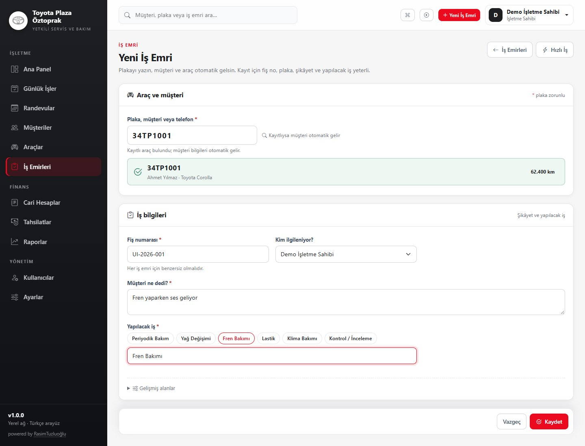

# Toyota Plaza Öztoprak · Servis Yönetimi

Toyota Plaza Öztoprak için geliştirilen bu uygulama; müşteri, araç, iş emri, cari hesap,
tahsilat ve randevu süreçlerini **tek bir yerel ağ uygulamasında** toplar. Veri işletmenin
kendi bilgisayarında kalır; bulut hesabı, dış servis veya port yönlendirme gerekmez.

> Güncel durum: üretim ve demo ortamı çalışıyor · **95 otomatik test** · yerel CI + Docker imaj doğrulaması

## Öne Çıkanlar

**Operasyon**
- Günlük iş panosu: bitmemiş işler her gün devreder, bitenler ertesi gün listeden kalkar.
- Kanban üzerinde sürükle-bırak veya tek tıkla durum ilerletme; plaka/müşteri araması.
- Yoğun günler için kompakt kart, sabit yükseklikte kayan kolonlar, yaş filtreleri ve katlanabilir biten kolonları; fiş no kompakt kartta da görünür.
- Telefonda **Bekliyor / İşlemde / Tamamlandı / Teslim Edildi** sekmeleri.
- Yeni İş Emri tek ekran: plaka, müşteri şikâyeti, yapılacak iş ve sorumlu kişi; müşteri/araç listesi ve gereksiz alanlar gizli.
- Sıradaki fiş no önerisi, yazarken mükerrer kontrolü ve sade düzenleme ekranı.
- Plaka ile hızlı iş emri: kayıtlı plakada müşteri/araç otomatik gelir; yeni plakada müşteri + araç + iş emri tek adımda oluşur.
- Hazır işlem düğmeleri, tek ekranda **Kaydet ve Tamamla**.
- Randevuyu otomatik “Geldi” yapıp plakası ön dolu yeni iş emrini açma.
- Günlük ve haftalık randevu takvimi; bakım hatırlatmaları (180 gün / 10.000 km).
- Ctrl+K komut paleti, 6 adımlık sunum turu, zorunlu manuel fiş numarası ve hazır kalem şablonları.
- Müşteri ve araç **Pasife Al / Geri Al**: geçmiş korunur, listeler varsayılan olarak aktifleri gösterir.

**Finans**
- İş emri tamamlanınca otomatik cari borç; iptalde ters kayıt (silme yok).
- Tamamla + tahsilat: **Cari / Nakit / Kart**.
- Tek açık borçta tutar/dağıtım otomatik; çoklu borç dağıtımı, tahsilat iptali, cari ekstre ve yaşlandırma.
- Excel (.xlsx), CSV ve PDF çıktıları; dashboard ve raporlar.

**Belgeler ve marka**
- Araç kabul formu, teslim tutanağı, ıslak imza çıktısı ve dijital imza.
- White-label: işletme adı, slogan, ana renk ve logo; giriş, menü, belgeler ve PDF’lerde geçerli.
- İş emri ve tahsilat makbuzu için doğrudan PDF indirme.

**Güvenlik, veri ve bakım**
- PATRON / MUHASEBE / SERVIS rolleri; yetkiler sunucu tarafında uygulanır.
- CSRF, BCrypt (strength 12), oturum sabitleme, 5 hatalı girişte 15 dakika kilit.
- İşlem denetim kaydı: kullanıcı, zaman, IP ve detay.
- Tek seferlik kurulum; kullanıcılar silinse bile `/setup` yeniden açılmaz.
- Günlük otomatik yedek + güncelleme öncesi yedek; kaçırılan yedek açılışta telafi edilir.
- Yedek indirme, geri yükleme tatbikatı ve otomatik yeniden başlayan güncelleme ajanı.
- Ayarlar → GitHub son commit kontrolü ve host ajanıyla Docker üzerinden güncelleme.

Kapsam dışı: e-fatura, banka/kart ödeme kuruluşu entegrasyonu, otomatik SMS/WhatsApp,
bulut dış erişim, çok işletmeli SaaS, tam stok/depo, native mobil uygulama, tam muhasebe sistemi.

## Ekran Görüntüleri

| Ana Panel | Günlük İşler |
|---|---|
|  |  |

| Yeni İş Emri | Giriş |
|---|---|
|  |  |

## Hızlı Başlangıç (Docker)

1. Ortam dosyasını oluşturun:

   ```bash
   cp .env.example .env
   ```

   Windows PowerShell: `Copy-Item .env.example .env`

2. `.env` içinde en az `POSTGRES_PASSWORD` değerini değiştirin. İlk işletme sahibini
   ortam değişkeninden oluşturmak isterseniz `INITIAL_ADMIN_USERNAME`,
   `INITIAL_ADMIN_PASSWORD` ve `INITIAL_ADMIN_FULL_NAME` değerlerini de doldurun.
   **Varsayılan parola yoktur.**

3. Servisleri başlatın:

   ```bash
   docker compose up -d --build
   docker compose ps
   docker compose logs -f app
   ```

4. Tarayıcıdan `http://localhost:18080` adresini açın. İlk kurulumda `/setup` ekranından
   PATRON (işletme sahibi) hesabını oluşturun. Bu ekran **yalnızca bir kez** açılır.

5. Durdurma:

   ```bash
   docker compose down
   docker compose restart app
   ```

   > `docker compose down -v` **volume’ları siler** ve veritabanı kayıtlarını geri
   > döndürülemez biçimde kaybettirir. Normal kullanımda `-v` kullanmayın.

PostgreSQL portu ana compose dosyasında bilerek yayınlanmaz. Yerel geliştirmede veritabanına
host üzerinden erişmek için:

```bash
docker compose -f docker-compose.yml -f compose.dev.yml up -d db
```

Bu komut portu yalnızca `127.0.0.1:5432` üzerinde açar.

## Demo / Sunum Ortamı

Gerçek veriyi kirletmeden sistemi göstermek için ayrı veritabanı ve port kullanılır.

```bash
docker compose up -d --build
docker compose -f docker-compose.demo.yml up -d
```

- Adres: `http://localhost:18081`
- Kullanıcı: `demo` · Parola: `DemoPass1234`
- Veri: 12 müşteri, 12 Toyota araç, 12 iş emri, 5 tahsilat, 4 randevu.
- Demo verisi yalnızca `demo` profilinde ve boş veritabanında oluşturulur; üretim verisine dokunmaz.
- Sıfırlama: `docker compose -f docker-compose.demo.yml down -v` → `... up -d`

### 5 dakikalık sunum akışı

1. **Giriş** → `demo / DemoPass1234`
2. **Ana Panel** → açık iş, bugünkü tahsilat, alacak, randevu ve teslimata hazır araçlar.
3. **Günlük İşler** → sekmeler/arama; bir işte **Cari/Nakit/Kart** seçip **Tamamla**; **Geri Al**.
4. **Yeni İş Emri** → `34 TP 1001` yazın; müşteri/araç otomatik gelsin; şikâyet ve işi girip **Kaydet**.
5. **Randevular** → **İş Emri Aç**; randevu “Geldi” olur, plaka dolu yeni iş emri açılır.
6. **Teslimata hazır** → **Teslim Et**; teslim ekranında bakiye ve **Tahsilat Al**.
7. **Tahsilat/Raporlar** → makbuz PDF’i, cari ekstre ve Excel/CSV indirme.
8. **Ayarlar** → yedekleme ve **Güncelleme** kartı.

## Roller ve Günlük Akış

| Rol | Kapsam |
|---|---|
| **PATRON** | Tüm işlemler: operasyon, finans, raporlar, kullanıcılar, ayarlar, yedekleme, güncelleme |
| **MUHASEBE** | Tahsilat, cari hesap, raporlar ve dashboard; müşteri/araç/iş emrini görüntüler, iş emrini iptal edebilir |
| **SERVIS** | Müşteri, araç, iş emri ve günlük akış; finans ekranlarına erişemez, tahsilat alamaz, iptal edemez |

İş emri akışı:

```text
Bekliyor → İşlemde → Tamamlandı → Teslim Edildi
    └──────────┴──────────┴──────→ İptal (ters kayıt)
```

- Tamamlamadan sonra 10 dakika içinde **Geri Al**; borç varsa ters kayıt oluşur.
- Tahsilat, iptal ve ters kayıtlar denetim kaydına yazılır.

## Teknolojiler

| Katman | Teknoloji |
|---|---|
| Dil | Java 21 LTS |
| Çatı | Spring Boot 3.5.16 |
| Web | Spring MVC + Thymeleaf |
| Veri | Spring Data JPA / Hibernate, PostgreSQL 16 |
| Dışa aktarma | Apache POI 5.5.1 (Excel .xlsx), UTF-8 BOM CSV |
| PDF | OpenPDF 2.2.2, Noto Sans (gömülü Türkçe karakter desteği) |
| Migration | Flyway (V16) |
| Güvenlik | Spring Security, BCrypt (strength 12), CSRF |
| UI | Bootstrap 5.3.3, Bootstrap Icons, özel CSS |
| Test | JUnit 5, Spring Boot Test, MockMvc, Testcontainers (PostgreSQL 16) |
| Paketleme | Maven, Docker, Docker Compose |

## Yerel Geliştirme

```bash
# 1) PostgreSQL 16
docker compose -f docker-compose.yml -f compose.dev.yml up -d db

# 2) Uygulama
set DB_URL=jdbc:postgresql://localhost:5432/servisdefteri
set DB_USERNAME=servisdefteri
set DB_PASSWORD=<.env icindeki POSTGRES_PASSWORD>
mvn spring-boot:run -Dspring-boot.run.profiles=dev
```

PowerShell:

```powershell
$env:DB_URL="jdbc:postgresql://localhost:5432/servisdefteri"
$env:DB_USERNAME="servisdefteri"
$env:DB_PASSWORD="..."
mvn spring-boot:run "-Dspring-boot.run.profiles=dev"
```

Varsayılan port `18080`’dir. Port doluysa `SERVER_PORT` (uygulama) veya `APP_PORT` (Docker)
ile değiştirin.

## Ortam Değişkenleri

| Değişken | Açıklama | Varsayılan |
|---|---|---|
| `POSTGRES_DB` | Veritabanı adı | `servisdefteri` |
| `POSTGRES_USER` | Veritabanı kullanıcısı | `servisdefteri` |
| `POSTGRES_PASSWORD` | Veritabanı parolası | Zorunlu |
| `APP_PORT` | Docker’da dış port | `18080` |
| `APP_BIND_ADDRESS` | Dinlenecek ağ arayüzü; `127.0.0.1` = yalnızca bu bilgisayar, `0.0.0.0` = yerel ağ | `0.0.0.0` |
| `SERVER_PORT` | Uygulama portu | `18080` |
| `SESSION_TIMEOUT` | Oturum süresi | `2h` |
| `DB_URL` | JDBC adresi | `jdbc:postgresql://localhost:5432/servisdefteri` |
| `DB_USERNAME` / `DB_PASSWORD` | Uygulama DB kullanıcısı | `servisdefteri` / zorunlu |
| `INITIAL_ADMIN_USERNAME` | İlk PATRON kullanıcı adı | Boş |
| `INITIAL_ADMIN_PASSWORD` | İlk PATRON parolası | Boş |
| `INITIAL_ADMIN_FULL_NAME` | İlk PATRON ad soyad | `İşletme Sahibi` |
| `BACKUP_ENABLED` | Zamanlanmış yedekleme | `true` |
| `BACKUP_DIR` | Yedek dizini | `./backups` (Docker: `/app/backups`) |
| `BACKUP_RETENTION_DAYS` | Yedek saklama süresi | `14` |
| `BACKUP_CRON` | Yedekleme cron ifadesi | `0 0 2 * * *` |
| `PG_DUMP_PATH` | pg_dump yolu | `pg_dump` |
| `DB_HOST` / `DB_PORT` / `DB_NAME` | Yedekleme bağlantısı | `localhost` / `5432` / `servisdefteri` |
| `APP_UPDATE_ENABLED` | Ayarlar’daki güncelleme özelliği | `true` |
| `APP_UPDATE_DIR` | Host ajanıyla paylaşılan klasör | `./updates` (Docker: `/app/updates`) |
| `APP_UPDATE_REPO` | İzlenecek GitHub deposu | `Rasimtuzluoglu/toyo` |
| `APP_UPDATE_GITHUB_TOKEN` | Özel depo için GitHub token | Boş |
| `GIT_COMMIT` | Docker imajına yazılan sürüm etiketi | `unknown` |

`.env` dosyası Git’e eklenmez. Örnek değerler `.env.example` içindedir.

## Yedekleme ve Güncelleme

**Otomatik yedek**
- Varsayılan her gün **02:00** (`BACKUP_CRON`), `pg_dump` custom format.
- 14 gün saklanır (`BACKUP_RETENTION_DAYS`); Docker’da `servisdefteri-backups` volume’ünde.
- **Her yazılım güncellemesinden önce** ayrıca `pre-update-...dump` alınır; yedek alınamazsa güncelleme durur.
- Manuel **Sunucuda Yedekle** ve **Yedek Al ve İndir** (PATRON).
- Yedek aynı bilgisayarda durur; disk arızasına karşı harici disk/NAS’a kopyalayın.
- Ayrıntılar: [Yedekleme ve Geri Yükleme](docs/BACKUP-RESTORE.md) · tatbikat: `scripts/restore-drill.ps1`

**Ayarlar → Yazılım Güncellemesi**
- **Kontrol Et**: GitHub’daki son commit’i gösterir.
- **Güncelle ve Yeniden Başlat**: host ajanına istek bırakır; ajan yedek alır,
  `git pull --ff-only origin main` yapar, `docker compose up -d --build` ile yeniden kurar
  ve sağlık kontrolü yapar.
- Ajan kurulumu (tek seferlik):

  ```powershell
  powershell -ExecutionPolicy Bypass -File .\scripts\install-update-agent.ps1
  ```

- Güncelleme sırasında uygulama 1–3 dakika erişilemez; oturumlar kapanır.
- Otomatik yakalama için `UPDATE_AUTO=true` ortam değişkeniyle ajanı başlatın.
- Günlükler: `updates/agent.log`, `updates/update.log`.

## Testler ve Yerel CI

```bash
mvn test
```

Testler gerçek PostgreSQL 16 üzerinde Testcontainers ile çalışır; Docker erişimi gerekir.
Kapsam: cari bakiye/tutar hesapları, durum geçişleri, müşteri-araç-iş emri-tahsilat akışı,
mükerrer borç/plaka/tahsilat kontrolleri, rol yetkileri, panonun devir/bitiş davranışı,
plaka araması, yaş filtreleri, Flyway migration ve kısıtlar, CSRF/form belirteci,
tüm ana sayfaların render’ı, PDF/Excel/CSV çıktıları, araç kabul/teslim ve randevu akışı.

Son çalıştırma: **95 test, 0 hata** (`mvn clean package`). Rapor: `target/surefire-reports/`.

### Yerel CI

```powershell
# Testler + Docker imajı
powershell -ExecutionPolicy Bypass -File .\scripts\ci-local.ps1

# İsteğe bağlı: her push öncesi otomatik çalışsın
powershell -ExecutionPolicy Bypass -File .\scripts\install-ci-hook.ps1
```

- Docker Desktop açık olmalıdır.
- Log: `logs/ci-local.log`.
- Pre-push hook, test veya Docker build başarısızsa push’u durdurur.
- Kaldırmak için `.git/hooks/pre-push` dosyasını silin.

## Proje Yapısı

```text
src/main/java/tr/com/servisdefteri/
  account/      cari hareketler, bakiye, ters kayıt
  appointment/  randevular
  audit/        denetim kaydı
  backup/       pg_dump yedekleme
  common/       ortak hata, doğrulama, CSV, format
  config/       güvenlik, web, ilk işletme sahibi
  customer/     müşteri modülü
  dashboard/    ana panel
  payment/      tahsilat ve dağıtım
  report/       raporlar ve CSV
  search/       global arama
  security/     kullanıcı, rol, oturum, tek seferlik kurulum
  settings/     ayarlar, marka ve audit ekranı
  update/       GitHub sürüm kontrolü ve host ajanı isteği
  vehicle/      araç modülü
  workorder/    iş emri, kalem ve belgeler
src/main/resources/
  db/migration/ Flyway migration dosyaları
  templates/    Thymeleaf şablonları
  static/       CSS, JavaScript ve varsayılan logo
scripts/        başlatma, yedek tatbikatı, CI, güncelleme ajanı
updates/        uygulama ↔ host ajanı çalışma dosyaları
docs/           mimari, veritabanı, kurulum, yedekleme, kullanım
```

## Dokümantasyon

- [Mimari](docs/ARCHITECTURE.md)
- [Veritabanı](docs/DATABASE.md)
- [Kurulum](docs/INSTALLATION.md)
- [Yedekleme ve Geri Yükleme](docs/BACKUP-RESTORE.md)
- [Kullanıcı Rehberi](docs/USER-GUIDE.md)
- [Case Study](docs/CASE-STUDY.md)
- [Demo Video Senaryosu](docs/DEMO-VIDEO-SCRIPT.md)

## Güvenlik ve Yerel Ağ Notları

- Uygulama yerel ağ içindir; internete açmayın, modemde port yönlendirmeyin.
- Tablet/telefon aynı Wi-Fi’den `http://<sunucu-ip>:18080` ile bağlanır.
- Windows Güvenlik Duvarı’nda yalnızca **özel ağ** profiline izin verin.
- Yerel ağda HTTPS yoktur; güvenilir ve parola korumalı bir Wi-Fi kullanın.
- Tüm yetki kontrolleri sunucu tarafındadır; menü/buton gizleme tek başına güvenlik sayılmaz.
- CSRF açıktır; formlar POST/Redirect/GET düzenindedir.
- Finansal iptaller PATRON/MUHASEBE ile sınırlıdır; iş emri durum geçişleri PATRON/SERVIS yetkisindedir.
- Parola, oturum belirteci ve gereksiz kişisel veri loglanmaz.
- Üretimde `spring.jpa.hibernate.ddl-auto=validate`; şema yalnızca Flyway ile değişir.
- Yedek dosyaları web kökünde değildir; indirme yalnızca PATRON oturumuyla yapılır.

## Lisans / Kullanım

Bu proje Toyota Plaza Öztoprak için yerel işletme kullanımı amacıyla geliştirilmiştir.
Gerçek müşteri verileriyle kullanmadan önce kendi yedekleme ve erişim politikanızı uygulayın.

---

<sub>powered by [RasimTuzluoğlu](https://www.linkedin.com/in/rasimtuzluoglu311/)</sub>
