# Toyota Servis — Son Kullanıcı UX İncelemesi

**Tarih:** 11.11.2026  
**Kapsam:** Demo ortamı, PATRON / MUHASEBE / SERVIS rolleri, masaüstü (1440×900) ve mobil (390×844)  
**Yöntem:** Baştan aşağıya gezinme, form ve liste kullanımı, durum akışı, yedek alma/indirme/geri yükleme testi  
**Üretim sürümü:** `0f8f62b` — sağlık `UP`, V18 migration uygulandı, port `127.0.0.1:18080`

> **Uygulanan hızlı düzeltmeler (11.11.2026):** Mobil müşteri/araç/iş emri/cari/tahsilat listeleri kart düzenine geçirildi; sabit kaydet çubuğu formun altına alındı; panodaki ikinci arama ve yinelenen “Yeni İş Emri” kaldırıldı; yedek ekranındaki “Otomatik: Kapalı” etiketi ve manuel yedek düğmeleri düzeltildi; “Kalıcı Sil” taşma menüsüne taşındı; süreçteki “Bekliyor” metni “Henüz yapılmadı” oldu. Tahsilat/alacak **yeşil**, borç **kırmızı** gösteriliyor. Düzeltme sonrası ekranlar: `docs/ux-review/fixes/`.

---

## 1. Yönetici özeti

Uygulama günlük servis akışını uçtan uca karşılıyor. Özellikle **pano kartları**, **Günlük Döküm mobil kartları** ve **yedekleme altyapısı** güçlü. Buna karşılık en büyük sorun **mobilde geniş tabloların kritik kolonları ve işlem düğmelerini ekran dışında bırakması**. İkinci büyük sorun, sabit alt menü ile yapışkan “Kaydet” çubuğunun form alanlarını örtmesi.

| Öncelik | Bulgu | Etki |
|---|---|---|
| **P1** | Müşteri, araç, iş emri, cari hesap ve tahsilat tabloları mobilde taşıyor | Durum, tutar ve “Detay” görünmüyor; işlem yapmak için yatay kaydırma gerekiyor |
| **P1** | Yapışkan kaydet çubuğu + sabit alt menü formu örtüyor | “Müşteri ne dedi?”, “Yapılacak iş” ve “Kaydet ve Yeni” erişilemiyor |
| **P1** | Aynı ekranda iki arama alanı ve iki “Yeni İş Emri” düğmesi | Kullanıcı hangisini kullanacağını bilemiyor; görsel gürültü |
| **P2** | Dashboard ve Ayarlar çok uzun / teknik | Günlük iş için gereken bilgiye ulaşmak zorlaşıyor |
| **P2** | Yedek ekranındaki “Devre Dışı” etiketi ile çalışan manuel yedek çelişiyor | Kullanıcı yedeğin bozuk olduğunu düşünebilir |
| **P2** | “Kalıcı Sil” işlemleri normal işlem düğmeleriyle aynı seviyede | Yanlışlıkla kalıcı veri kaybı riski |
| **P3** | “Bekliyor” kelimesi süreç zaman çizelgesinde kalmış | Yeni 3 aşamalı akışla kavram çelişkisi |

> **Yedekleme sonucu:** Manuel yedek, indirme ve gerçek geri yükleme testleri **başarılı**. Ayrıntılar bölüm 3’te.

---

## 2. Beğendiklerim / korunması gerekenler

- **3 aşamalı pano akışı** sade ve anlaşılır: İşlemde → Tamamlandı → Teslim Edildi.
- **Pano kartları** mobilde temiz; plaka, müşteri, süre, tutar ve tek ana eylem görünüyor.
- **Günlük Döküm mobil kartları** en iyi örnek: durum, müşteri, araç, hizmet, toplam/tahsilat/kalan tek kartta okunuyor.
- **Rol bazlı menü** doğru çalışıyor; MUHASEBE finans odaklı, SERVIS doğrudan panoya düşüyor.
- **Yedek başarı bildirimi** net: “Yedekleme tamamlandı: dosya adı”.
- **Yedek geçmişi** dosya adı, boyut, tetikleyen ve indirme bağlantısını gösteriyor.

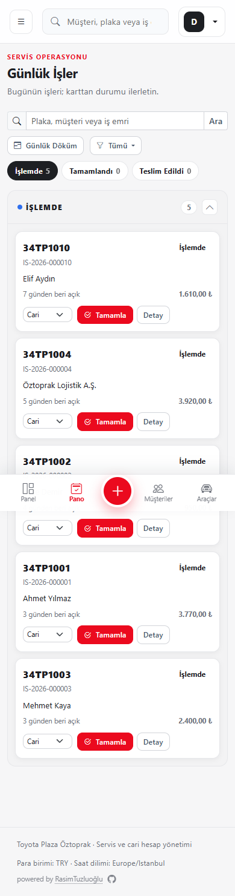

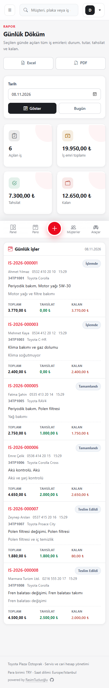

---

## 3. Yedekleme doğrulaması (öncelikli)

### 3.1 Yapılan testler

| Test | Sonuç | Kanıt |
|---|---|---|
| Manuel sunucu yedeği | **Başarılı** | `servisdefteri-20261111-200430.dump`, 75.771 bayt |
| Yedek dosyası bütünlüğü | **Başarılı** | `pg_restore --list` → 180 TOC girdisi, custom format |
| “Yedek Al ve İndir” | **Başarılı** | 75.924 bayt indirildi; SHA-256 sunucudaki dosyayla **birebir aynı** |
| Demo geri yükleme | **Başarılı** | Geçici DB: 12 müşteri / 12 araç / 12 iş emri / 5 tahsilat |
| Üretim güncelleme öncesi yedek | **Başarılı** | `pre-update-20261111-195220.dump`, 71 KB |
| Üretim geri yükleme | **Başarılı** | Geçici DB: 1 müşteri / 1 araç / 1 iş emri / 1 tahsilat / 1 cari hareket |
| Otomatik / telafi yedeği | **Başarılı** | `backup_runs`: 03, 06, 08 ve 11 Kasım `TELAFI` kayıtları |

### 3.2 Yedek ekranındaki sorunlar

1. **“PostgreSQL Yedekleme — Devre Dışı”** etiketi, otomatik yedeklemenin kapalı olduğunu anlatıyor; ancak manuel yedek çalışıyor. Etiket “Otomatik yedekleme kapalı” olmalı.
2. Demo’da `BACKUP_ENABLED=false` olduğu için **“Sunucuda Yedekle” ve “Yedek Al ve İndir” düğmeleri disabled**. Backend manuel yedeği kabul ediyor; yani düğmeler gereksiz yere kilitli. Üretimde `BACKUP_ENABLED=true` olduğu için düğmeler açık, ancak otomatik yedek kapatılırsa manuel yedek de UI’dan kaybolur.
3. Boş geçmiş metni **“Şimdi Yedekle”** diyor; gerçek düğme **“Sunucuda Yedekle”**. Terim birliği yok.
4. **Uygulama içinde geri yükleme akışı yok.** Uyarı metni `docs/BACKUP-RESTORE.md` adresine yönlendiriyor; saha kullanıcısı için bu teknik bir adım. En azından “Son yedek sağlıklı” ve “Geri yükleme testi nasıl yapılır?” bağlantısı daha görünür olmalı.
5. Yedek geçmişi tablosu mobilde 6 kolon; dosya adı ve “İndir” daralıyor. Mobilde kart veya 4 kolon (tarih, durum, boyut, indir) yeterli.

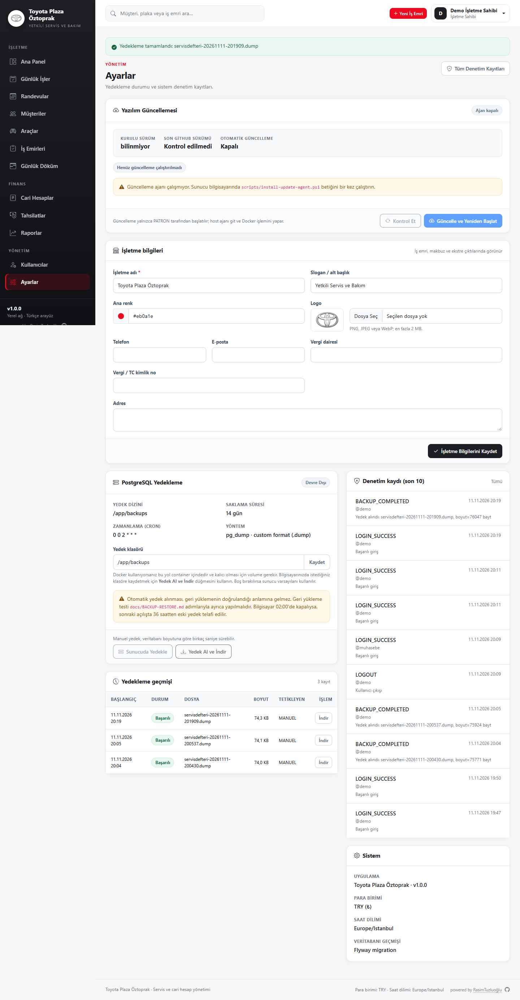

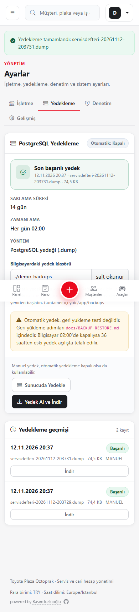

---

## 4. Mobil kullanımda zorlandığım yerler

### 4.1 Geniş tablolar kritik bilgiyi gizliyor (P1)

**Müşteriler:** Ekranda yalnızca müşteri, tür, telefon ve e-posta görünüyor. **Durum, kayıt tarihi ve “Detay” işlemi ekran dışında.** E-posta adresleri de kesiliyor.

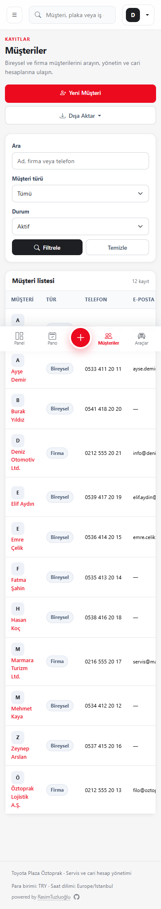

**İş Emirleri:** Durum, toplam ve “Detay” kolonları görünmüyor. İş emri numarası ve kilometre alt alta kırıldığı için satırlar aşırı uzuyor.

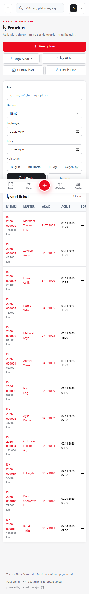

**Cari Hesaplar:** “İşlem” kolonu (Ekstre / Tahsilat) ekran dışında; kullanıcı listeden işlem başlatamıyor.

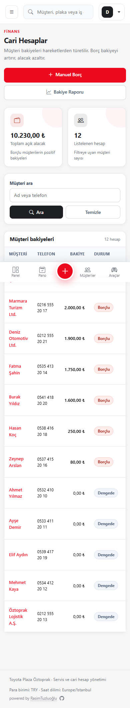

**Tahsilatlar:** Tutar, durum ve “Detay” görünmüyor; “Kredi/Banka Kartı” metni kesiliyor.

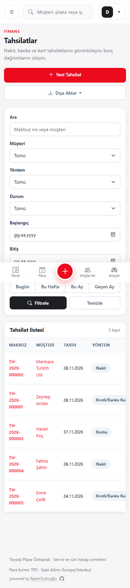

**Cari Ekstre:** 4 KPI kartı tek satırda taşıyor; dördüncü kart kesiliyor. 7 kolonlu hareket tablosu mobilde okunamıyor.

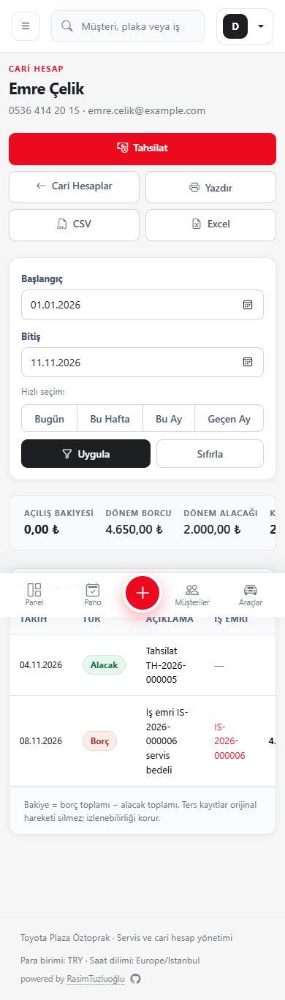

**Öneri:** Günlük Döküm’deki mobil kart desenini Müşteri, Araç, İş Emri, Cari Hesap ve Tahsilat listelerine uygulayın. Kartta ad/plaka, durum, tutar ve tek “Detay” bağlantısı olsun. Alternatif olarak ikincil kolonları mobilde gizleyip satırın tamamını tıklanabilir yapın.

### 4.2 Sabit alt menü ve yapışkan kaydet çubuğu formu örtüyor (P1)

Yeni iş emri formunda kırmızı **Kaydet** çubuğu “Müşteri ne dedi?” alanının üstüne biniyor; alt menü de “Müşteri ne dedi?” ve “Yapılacak iş” alanlarını kapatıyor. **“Kaydet ve Yeni”** düğmesi tamamen alt menünün arkasında kalıyor.

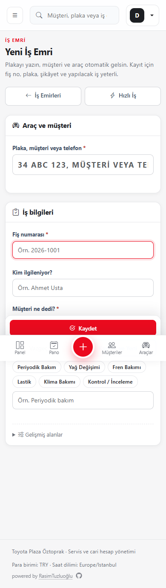

Aynı sorun randevu formunda “Not” alanında ve Ayarlar sayfasında işletme bilgileri formunda da var.

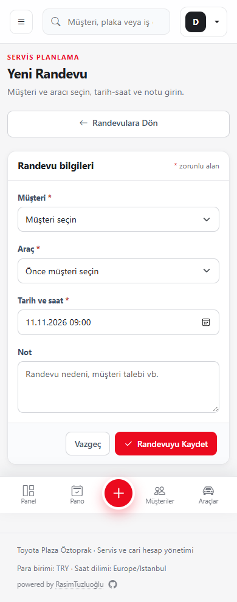

**Öneri:**
- `.sd-content` / form kapsayıcısına alt menü yüksekliği kadar `padding-bottom` ekleyin.
- `.quick-actions` için mobilde `bottom: 72px` (alt menü yüksekliği + boşluk) kullanın.
- Yapışkan çubuğu formun altına sabitleyin; alanların üzerine binmesin.
- Mobilde tek ana “Kaydet” gösterin; “Kaydet ve Yeni”yi ikincil menüye alın.

### 4.3 Filtre panelleri ekranın yarısını kaplıyor (P2)

İş emirleri ve tahsilatlar ekranlarında 5–6 filtre alanı, hızlı tarih düğmeleri ve Filtrele/Temizle düğmeleri mobilde neredeyse tam bir ekran. Liste ancak aşağı kaydırınca başlıyor.

**Öneri:** Filtreleri varsayılan olarak kapalı bir “Filtre” çekmecesine alın; aktif filtre sayısını rozetle gösterin. Hızlı tarih seçimlerini çekmece içinde tutun.

---

## 5. Görsel olarak fazla / sadeleştirilmesi gerekenler

### 5.1 Dashboard çok uzun ve tekrarlı (P2)

Masaüstü dashboard’da 11 ana bölüm var: 4 KPI, randevular, teslimata hazır, 7 gün tahsilat grafiği, iş emri durumları, bakım hatırlatmaları, devam eden işler, en yüksek borçlu, son cari işlemler, hızlı işlemler. “Hızlı işlemler” kartındaki 7 bağlantı sol menü ve üst bardaki bağlantıların tekrarı. “Bugünkü randevular” boşken çok büyük bir boş alan kaplıyor.

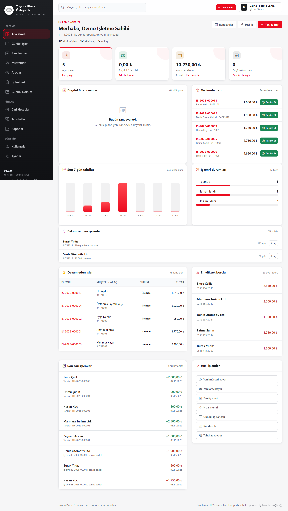

**Öneri:**
- İlk ekranda yalnızca 4 KPI + bugünün işleri + teslimata hazır + borçlu özeti kalsın.
- “Son cari işlemler”i 5 kayda düşürün; “Hızlı işlemler” kartını kaldırın.
- Boş randevu kartını tek satırlık kompakt boş duruma çevirin.
- Grafikleri ikincil sekme/“Daha fazla” altına alın.

### 5.2 Ayarlar sayfası teknik detaylarla dolu (P2)

İlk kart “Yazılım Güncellemesi” ve şu ifadeler var: “Ajan kapalı”, “KURULU SÜRÜM bilinmiyor”, “SON GITHUB SÜRÜMÜ Kontrol edilmedi”, “scripts/install-update-agent.ps1”, “host ajanı git ve Docker işlemini yapar”. Bunlar işletme sahibi için anlaşılır değil ve güveni sarsıyor. Denetim kaydı 10 satır, Sistem kartında “Flyway migration” gibi teknik terimler var.

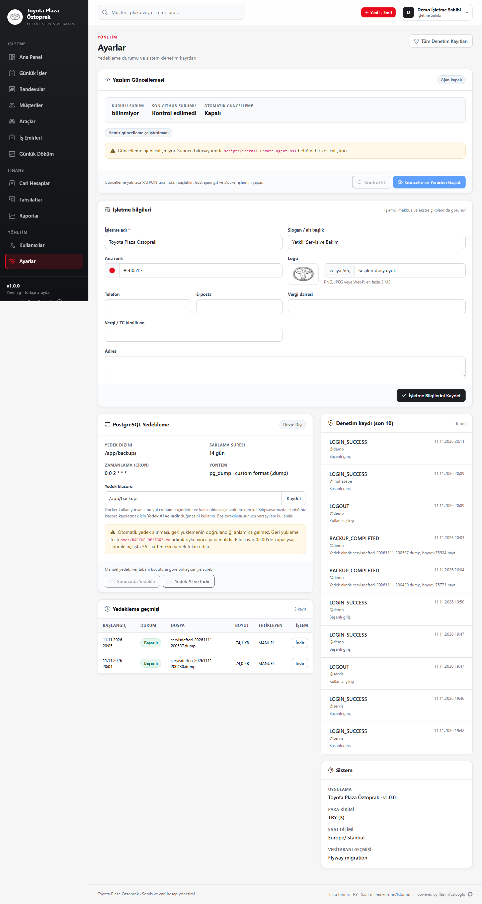

**Öneri:**
- Güncelleme/teknik durum kartını “Gelişmiş” bölümüne veya ayrı sayfaya taşıyın.
- “Kurulu sürüm bilinmiyor” yerine sürümü gösterin; ajan yoksa “Otomatik güncelleme kullanılmıyor” deyin.
- Ayarlar sayfasını “İşletme”, “Yedekleme”, “Güvenlik/Denetim” sekmelerine bölün.
- Denetim kaydını son 5 kayıt + “Tümünü gör” yapın.
- “Flyway migration” yerine “Veritabanı sürümü” yazın.

### 5.3 Raporlar açılış sayfası 9 büyük kart (P3)

Mobilde 9 kart alt alta, her biri yaklaşık 120 px; rapor seçmek için uzun kaydırma gerekiyor.

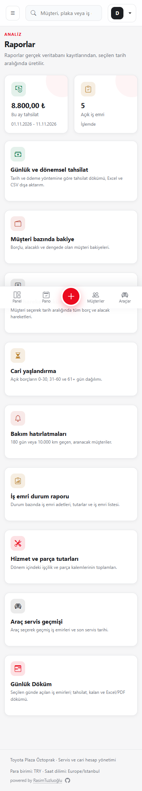

**Öneri:** “Finans”, “Operasyon”, “Dökümler” başlıkları altında 2–3 sütunlu kompakt liste kullanın.

### 5.4 İş emri detayı ve “Hazır kalem” alanı (P2)

Masaüstünde 6 üst eylem, 12 hazır kalem çipi, sürekli açık “Kalem ekle” formu ve 6 bağlantı var. Mobilde bu yoğunluk daha da artıyor; tablo ve özet şerit taşıyor.

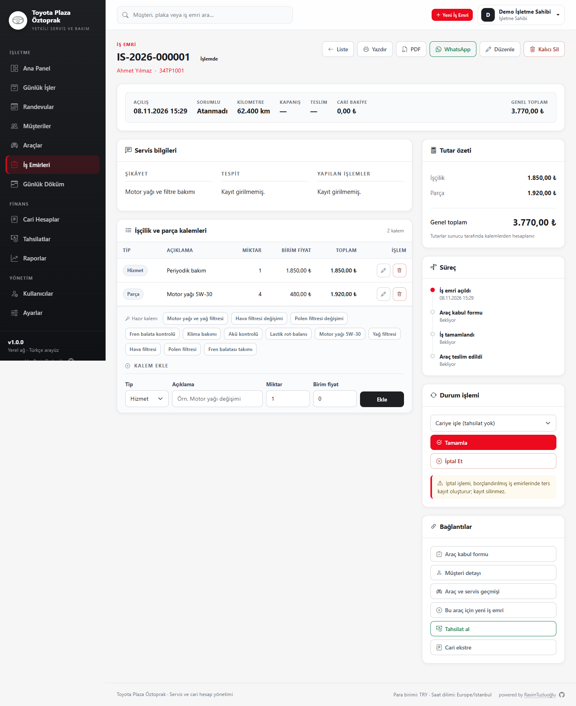

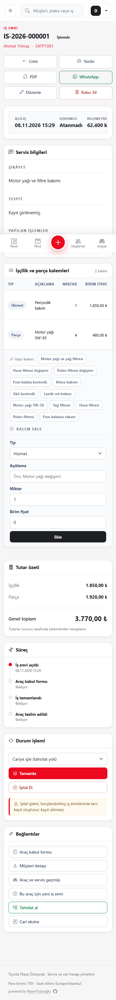

**Öneri:**
- “Hazır kalem”leri açılır liste/arama yapın; varsayılan kapalı olsun.
- “Kalem ekle” formunu “+ Kalem ekle” düğmesiyle açın.
- Üst eylemleri “Yazdır / PDF / WhatsApp” ve “Düzenle” olarak gruplayın; “Kalıcı Sil”i taşma menüsüne alın.
- Mobil özet şeridini 2×2 KPI’ya çevirin.

### 5.5 Müşteri detayında altı eylem ve tekrar eden bilgi (P2)

“İş Emri Aç”, “Liste”, “Düzenle”, “Pasife Al”, “Kalıcı Sil”, “Araç Ekle” aynı ekranda. “Kalıcı Sil” normal eylem gibi duruyor. Telefon/e-posta hem başlıkta hem “Müşteri bilgileri” kartında tekrar ediyor.

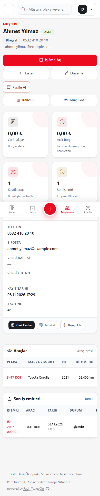

**Öneri:** Birincil eylem “İş Emri Aç”, ikincil “Düzenle”; “Pasife Al” ve “Kalıcı Sil” taşma menüsünde ve onaylı olsun. Tekrar eden iletişim bilgisini kaldırın.

---

## 6. Daha küçük ama önemli bulgular

| # | Bulgu | Öneri |
|---|---|---|
| 1 | Panoda üstte global arama + hemen altında ikinci “Plaka, müşteri veya iş emri” araması var | Tek arama kutusu; pano filtresini aynı kutuya bağlayın |
| 2 | Üst barda ve sayfa başlığında iki “Yeni İş Emri” düğmesi | Tek CTA bırakın |
| 3 | Panodaki kartlarda etiketsiz “Cari” seçimi | “Tahsilat: Cari/Nakit/Kart” etiketi veya “Tamamla” diyaloğu |
| 4 | İş emri süreç zaman çizelgesinde “Bekliyor” yazıyor | “Henüz yapılmadı” / “—” yapın |
| 5 | İş emri durum grafiğinde tüm çubuklar kırmızı | Durum renklerini (mavi/yeşil/lacivert) kullanın |
| 6 | Durum çubukları ve “Tamamla” düğmeleri aynı kırmızı ailede | Eylem rengini durum renginden ayırın |
| 7 | Mobilde 4 KPI’lı şeritler taşıyor (cari ekstre) | 2×2 grid’e çevirin |
| 8 | Sabit alt menü tablo başlıklarını ve kartları örtüyor | `padding-bottom` + `scroll-margin` düzeltmesi |
| 9 | Ayarlar’da “Yedek dizini” ve “Yedek klasörü” aynı bilgiyi tekrar gösteriyor | Tek alan |
| 10 | Yedekleme yöntemi “pg_dump · custom format (.dump)” teknik | “PostgreSQL yedeği” olarak sadeleştirin |
| 11 | Zamanlama “0 0 2 * * *” ham cron | “Her gün 02:00” gösterin |

---

## 7. Önerilen sıra

### Hızlı kazanımlar (1–2 gün)
1. Müşteri, araç, iş emri, cari hesap ve tahsilat listelerine **mobil kart** düzeni.
2. Alt menü + yapışkan kaydet çubuğu çakışmasını düzelt; formlara alt boşluk ekle.
3. Panodaki ikinci aramayı ve yinelenen “Yeni İş Emri”yi kaldır.
4. Yedek ekranındaki “Devre Dışı” etiketini “Otomatik yedekleme kapalı” yap; manuel yedek düğmelerini her durumda açık tut.
5. “Kalıcı Sil”i taşma menüsüne al; süreçteki “Bekliyor” metnini değiştir.
6. Panodaki “Cari” seçimini etiketle.

### Orta vadeli (3–5 gün)
1. Dashboard’u 5 bölüme indir; “Hızlı işlemler”i kaldır.
2. Ayarlar’ı sekmelere böl; güncelleme/sistem/audit detaylarını “Gelişmiş”e taşı.
3. İş emri detayında hazır kalemleri ve kalem ekle formunu katlanabilir yap.
4. Filtreleri mobilde çekmeceye al.
5. Raporlar açılışını kategorilere ayır.

### Yedekleme sertleştirme
1. “Son başarılı yedek” ve “Son geri yükleme testi”ni tek kartta göster.
2. Yedek geçmişine “İndir” yanında “Doğrula” (pg_restore --list) durumu ekle.
3. Otomatik yedek kapalı olsa bile manuel yedek düğmelerini etkin tut.
4. Geri yükleme için adım adım, ekran görüntülü bir “Yedekten Geri Yükle” rehberi ekle; mümkünse tek tık “test geri yükleme” yap.
5. Demo ortamında yedek kapatılsa bile “Manuel yedek kullanılabilir” açıklaması göster.

---

## 8. Ekran görüntüleri

Tüm görüntüler `docs/ux-review/` altında; masaüstü 1440×900, mobil 390×844 tam sayfa.

- `desktop-dashboard.png`, `mobile-dashboard.png`
- `desktop-board.png`, `mobile-board.png`
- `desktop-customers.png`, `mobile-customers.png`
- `desktop-vehicles.png`, `mobile-vehicles.png`
- `desktop-work-orders.png`, `mobile-work-orders.png`
- `desktop-work-order-detail.png`, `mobile-work-order-detail.png`
- `desktop-work-order-new.png`, `mobile-work-order-new.png`
- `desktop-appointments.png`, `mobile-appointments.png`
- `desktop-appointment-new.png`, `mobile-appointment-new.png`
- `desktop-daily-report.png`, `mobile-daily-report.png`
- `desktop-accounts.png`, `mobile-accounts.png`
- `desktop-account-statement.png`, `mobile-account-statement.png`
- `desktop-payments.png`, `mobile-payments.png`
- `desktop-reports.png`, `mobile-reports.png`
- `desktop-report-work-orders.png`, `mobile-report-work-orders.png`
- `desktop-users.png`, `mobile-users.png`
- `desktop-settings.png`, `mobile-settings.png`
- `desktop-settings-backup-success.png`, `mobile-settings-backup-success.png`
- `desktop-settings-audit.png`, `mobile-settings-audit.png`
